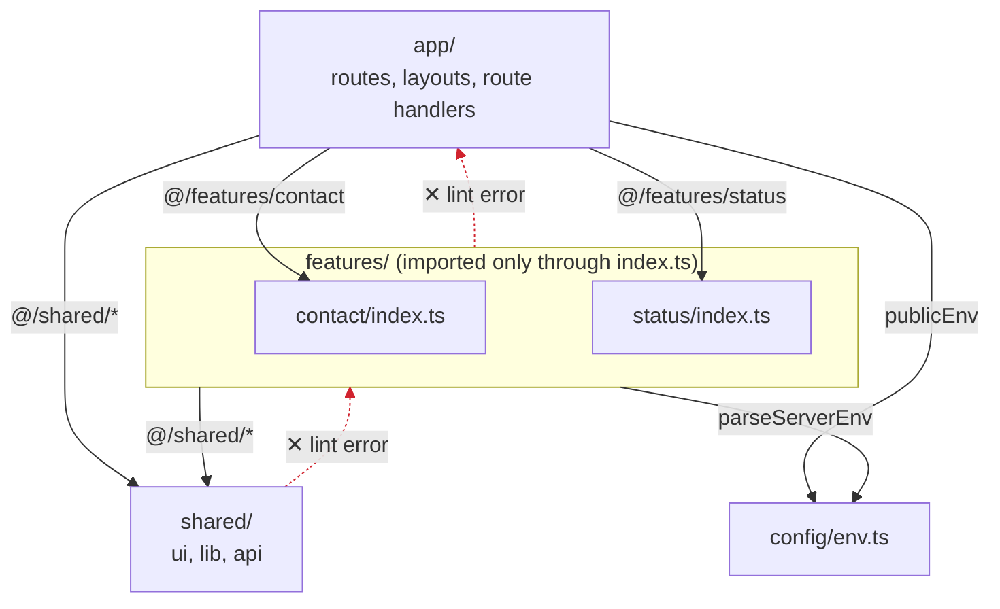
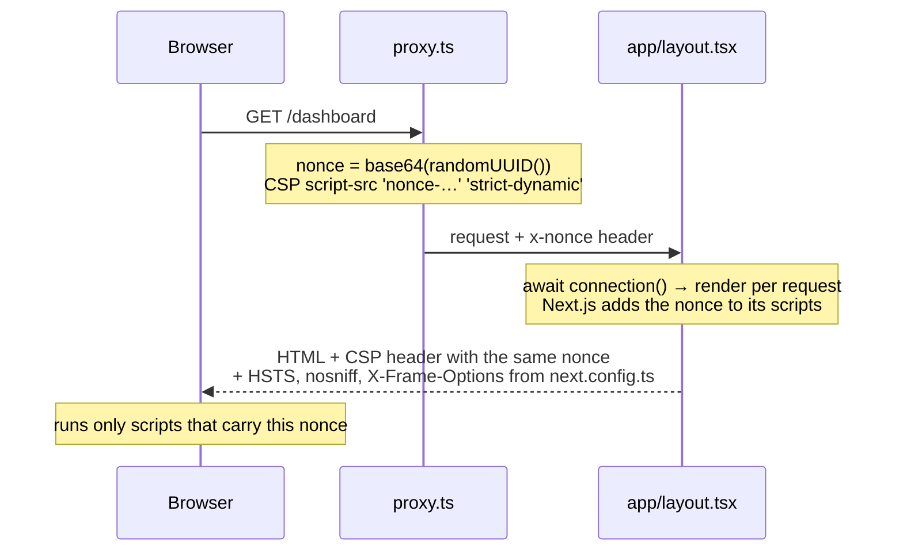
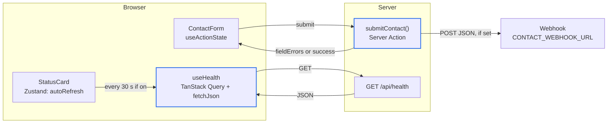
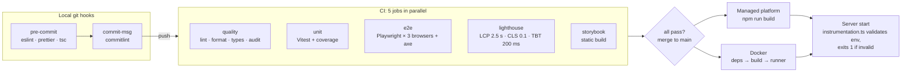

# Next.js Boilerplate

A production-ready starter for Next.js apps. It ships with strict TypeScript, Tailwind CSS, unit, component, end-to-end, and accessibility tests, a nonce-based Content Security Policy, and a CI pipeline that blocks merges when a check fails.

## Requirements

- Node.js 24 (see `.nvmrc`; run `nvm use`)
- npm 11 or newer. npm 10 cannot resolve this dependency tree, and `.npmrc` sets `engine-strict` so it fails with a clear message.

## Getting started

```bash
nvm use
cp .env.example .env.local   # fill in the values
npm install
npm run dev                  # http://localhost:3000
```

Confirm the setup:

```bash
npm test
npm run lint
npm run typecheck
```

## Scripts

| Script                    | What it does                                                               |
| ------------------------- | -------------------------------------------------------------------------- |
| `npm run dev`             | Start the dev server                                                       |
| `npm run build`           | Production build                                                           |
| `npm start`               | Serve the production build                                                 |
| `npm test`                | Unit and component tests (Vitest)                                          |
| `npm run test:watch`      | Tests in watch mode                                                        |
| `npm run test:coverage`   | Tests with a coverage report in `coverage/`                                |
| `npm run test:e2e`        | End-to-end and accessibility tests (Playwright); builds and starts the app |
| `npm run lint`            | ESLint, including module-boundary rules; fails on any warning              |
| `npm run format`          | Format every file with Prettier                                            |
| `npm run typecheck`       | Generate route types, then run the TypeScript compiler                     |
| `npm run storybook`       | Component workshop at http://localhost:6006                                |
| `npm run build-storybook` | Static Storybook build                                                     |
| `npm run lhci`            | Lighthouse CI against a production build (run `npm run build` first)       |

Before the first E2E run, install the browsers once with `npx playwright install`.

## Project structure

```text
app/                 routes, layouts, loading and error files (App Router)
  (marketing)/       public pages
  (app)/             signed-in pages
  api/               route handlers
features/            one folder per feature, exported through its index.ts
shared/
  ui/                design-system components
  lib/               pure helpers
  api/               fetch client and shared response schemas
config/              environment validation
proxy.ts             per-request CSP nonce (Next.js 16 replaced middleware.ts with proxy.ts)
tests/
  e2e/               Playwright specs
  fixtures/          MSW handlers shared by tests
docs/                architecture, how-tos, and decision records
```

Imports flow one way: `app` → `features` → `shared`. ESLint enforces this. Read [docs/architecture.md](docs/architecture.md) for details.



The red arrows fail `npm run lint`, and so does any import that reaches past a feature's `index.ts`, such as `@/features/contact/components/contact-form`.

## How it works

### Page requests and the CSP nonce



Every request gets a new nonce, so no page is prerendered ([ADR 0002](docs/adr/0002-nonce-csp.md)). API routes, static assets, and link prefetches skip the proxy.

### Reads and writes



The two blue-outlined nodes validate with Zod: the Server Action checks form input on the server, and `fetchJson` checks every API response before a component sees it.

### From commit to production



CI blocks a merge only after these five jobs are marked as required checks in the repository's branch protection settings.

## Environment variables

Every variable is listed in `.env.example` and validated at startup by `config/env.ts`. The server exits with a clear message if a value is missing or malformed. Only variables prefixed `NEXT_PUBLIC_` reach the browser.

## Deployment

The app runs on any Node.js host or managed Next.js platform.

- **Managed platform:** connect the repository. The platform runs `npm run build` and serves preview deployments for each pull request.
- **Docker:** `docker build -t app .` then `docker run -p 3000:3000 --env-file .env.production app`. The image uses Next.js standalone output and runs as a non-root user with a health check on `/api/health`.

See [docs/release-checklist.md](docs/release-checklist.md) before releasing.

## Documentation

- [Architecture](docs/architecture.md)
- [Adding a feature](docs/adding-a-feature.md)
- [Release checklist](docs/release-checklist.md)
- [Decision records](docs/adr/)
- [Contributing](CONTRIBUTING.md)
