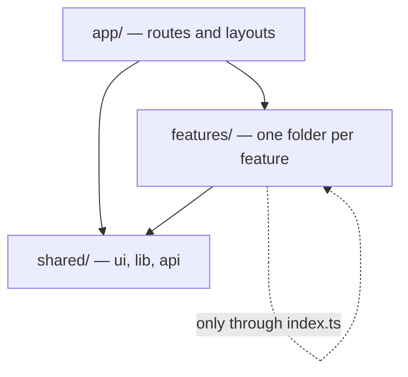

# Architecture

## Layers and import rules

Code lives in three layers. Imports only flow downward, and ESLint (`eslint.config.mjs`) fails the build when a rule is broken.

- **app/** holds thin route files. They compose features and contain no business logic.
- **features/** each own their components, hooks, Server Actions, schemas, and tests. Other code imports a feature only through `features/<name>/index.ts`.
- **shared/** holds code with no knowledge of any feature: design-system components, pure helpers, and the fetch client.
- **config/** validates environment variables.

## Rendering and data

- Pages are Server Components by default. Add `'use client'` only to components that need state, effects, or browser APIs.
- Writes go through Server Actions, which validate input with Zod. The server is the trust boundary; client checks are a convenience.
- Client-side reads use TanStack Query through `shared/api/http.ts`, which validates every response against a Zod schema.
- Schemas that run in the browser use `zod/mini`. Classic `zod` adds about 90 KB of compressed JavaScript and probes for `eval`, which the Content Security Policy reports as a violation. Keep classic `zod` in server-only code such as Server Actions and `config/env.ts`.
- Shared UI state lives in small Zustand stores inside the feature that owns it.

## Security

- `proxy.ts` sets a Content Security Policy with a fresh nonce per request. Next.js applies the nonce to its own scripts. Because each response carries a new nonce, every page renders dynamically ([ADR 0002](adr/0002-nonce-csp.md)).
- `next.config.ts` adds HSTS, `X-Content-Type-Options`, `Referrer-Policy`, `X-Frame-Options`, and `Permissions-Policy`, and removes `X-Powered-By`.
- Sessions, once added, belong in HTTP-only cookies, never in `localStorage`.
- Logs never include form contents, tokens, or personal data.

## Testing

| Layer         | Tool                         | Location                       |
| ------------- | ---------------------------- | ------------------------------ |
| Unit          | Vitest                       | next to the code, `*.test.ts`  |
| Component     | Vitest and Testing Library   | next to the code, `*.test.tsx` |
| API mocking   | MSW                          | `tests/fixtures/`              |
| End-to-end    | Playwright, three browsers   | `tests/e2e/`                   |
| Accessibility | axe in Playwright, Storybook | `tests/e2e/fixtures.ts`        |
| Performance   | Lighthouse CI                | `lighthouserc.json`            |

Unit tests fail on any network request that is not mocked.

## Performance budgets

Lighthouse CI runs on the home and dashboard routes with the default mobile profile and fails the build when a budget is exceeded: LCP 2.5 s, CLS 0.1, Total Blocking Time 200 ms, and 190 KB of compressed JavaScript. React and the Next.js runtime take about 140 KB of the JavaScript budget, which leaves about 50 KB for application code. Interaction to Next Paint can only be measured with real users, so Total Blocking Time stands in for it in the lab; track INP in production monitoring.
